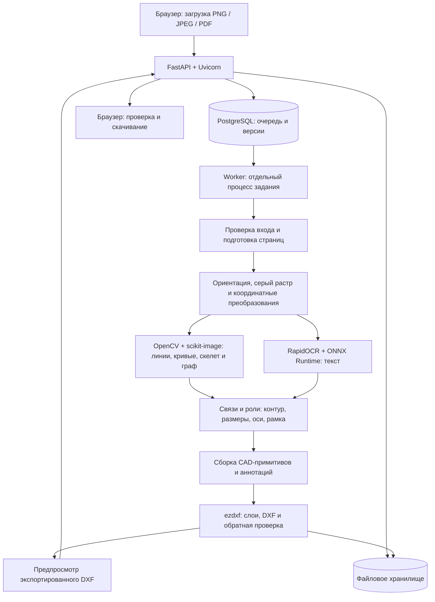

# ScannedDrawings2CAD

Локальный веб-сервис для преобразования сканов инженерных чертежей **PNG, JPEG и PDF** в редактируемый **DXF**. Проект разрабатывается совместно с **44labs**.

Пользователь загружает документ, выбирает профиль, просматривает исходник и результат, проверяет обнаруженные объекты и замечания, затем скачивает DXF отдельной страницы. Сервис хранит версии обработки, позволяет просматривать наблюдения и вносить поддерживаемые текстовые и табличные правки.

**Статус: предварительная демонстрационная версия.** Базовая линия выпуска — Web V27, контракт обработки `processing-profile/9.0`, вычислительное ядро профиля 8. Для демонстрации наиболее полного подключённого CAD-экспорта выбирается **«CAD · целые объекты и рамка (эксперимент)»** — `native_cad_layers_draft`. Этот профиль доступен в интерфейсе; действующий V27 по умолчанию выбирает более ранний `native_cad_draft`.

Рабочая копия подготовлена 24.11.2026 в `ScannedDrawings2CAD`. Включены локальные модели, PostgreSQL и библиотеки; отдельное Python-окружение создано заново для этой машины. Проверка V27 `--check` пройдена из нового каталога. [Краткий запуск](QUICKSTART.md). Одного `pip install -e .` при установке на другом компьютере недостаточно: также нужны локальные OCR-модели и бинарный runtime PostgreSQL.

## Архитектура

Сервис построен как локальное клиент-серверное приложение. Браузерный интерфейс использует HTML, CSS и JavaScript без отдельного Node.js-сервера. **FastAPI** принимает запросы и выдаёт результаты, **Uvicorn** обслуживает HTTP. **PostgreSQL** хранит задания, состояния, версии и правки; **psycopg** используется для доступа к БД. Оригиналы, рабочие изображения и DXF размещаются в файловом хранилище.

Обработка выполняется отдельными Python-процессами. Web-процесс остаётся доступным во время CV/OCR. Очередь и workers реализованы в проекте: они используют SQL, контроль владения заданием, heartbeat, отмену и ограничения ресурсов. Отдельные workers обслуживают преобразование документов и пользовательские правки. Redis и Celery для текущего маршрута не требуются.



Выбрана гибридная архитектура: классическое машинное зрение восстанавливает наблюдаемую геометрию, нейросетевой OCR распознаёт текст, а собственные геометрические проверки связывают наблюдения и формируют CAD-объекты. Это позволяет проверять происхождение каждого принятого объекта по исходному растру и сохранять спорные участки для ручной проверки.

## Последовательность обработки

| Этап | Что выполняется | Python-библиотеки и модули проекта |
| --- | --- | --- |
| 1. Приём задания | Проверка параметров и формата, сохранение оригинала, SHA-256, создание версии и задания | FastAPI, Pydantic, psycopg; `service_profiles_v22`, `service_profiles_v21`, `profile_contract_v9` |
| 2. Подготовка входа | Проверка PNG/JPEG, учёт EXIF, ограниченное по памяти чтение, создание рабочего обзора; PDF разбивается на страницы | Pillow, NumPy, собственный PNG-декодер на `zlib`; `raster_input_v2`, `raster_input_compat_v1`, `raster_stream_v2` |
| 3. Чтение PDF | Проверка структуры и страниц, растеризация; отдельная ветка может извлекать присутствующие векторные объекты и текст | pypdf, pypdfium2 / PDFium; `intake` |
| 4. Предобработка | Серое изображение для OCR, бинаризация для CV, поворот и оценка перекоса; сохранение преобразований координат | OpenCV, NumPy, Pillow; `preprocessing`, `demo_input_v1` |
| 5. Геометрические наблюдения | Поиск отрезков, окружностей и дуг, проверка пиксельной поддержки, получение скелета штриха и графа связности | OpenCV, NumPy, `scikit-image.morphology.skeletonize`; `geometry_detection`, `curve_graph_v1`, `experimental_cv_v1` |
| 6. OCR | Поиск текстовых областей, ориентация строк, распознавание текста по перекрывающимся окнам, объединение наблюдений | RapidOCR, ONNX Runtime, OpenCV; `ocr_engine`, `ocr`, `notation`, `title_recognition` |
| 7. Роли и связи | Поиск наконечников и размерных цепочек, проверки контактов и окружения, предложения ролей контура, оси, рамки и сетки штампа | Собственные алгоритмы на OpenCV и NumPy; `source_chain_profile_v2`, `joint_cv_profile_v1`, `source_region_roles_v1`, `native_frame_v1` |
| 8. Сборка объектов | Аппроксимация и объединение поддержанных фрагментов в целые примитивы, разделение составных путей, восстановление допустимых осевых групп | NumPy и геометрические алгоритмы проекта; `cad_object_assembly_v16`, `cad_axis_candidate_export_v1`, `cad_axis_contract_v1` |
| 9. Текст и размерные аннотации | Связывание OCR с исходными штрихами; создание текстовых сущностей и допустимых размерных объектов | ezdxf, OpenCV, NumPy, fontTools; `native_annotation_plan_v1`, `native_annotation_export_v2` |
| 10. Экспорт и контроль | Назначение DXF-слоёв, сохранение непринятых штрихов, проверка привязки к исходнику, повторное чтение DXF и аудит | ezdxf; `native_cad_layers_candidate_v2`, `cad_object_export_v2` |
| 11. Предпросмотр и публикация | Отрисовка фактически экспортированного DXF, выдача файлов и статусов полноты поиска | ezdxf drawing/SVG, PyMuPDF, Pillow; `annotation_style_v1`, `search_completeness_v1`, `profile_pipeline_v9` |

Внутренний `DrawingGraph` и связанные JSON-пакеты хранят координаты, связи, наблюдения и происхождение данных. Проект использует собственные графовые алгоритмы; наличие графа здесь не означает применение графовой нейросети.

В текущем Web-конвейере геометрия и роли вычисляются алгоритмами CV. YOLOX, обучаемые ролевые модели, альтернативные OCR и VLM исследуются отдельно; они не являются обязательными компонентами демонстрационного маршрута.

## OCR и модели

Используется **RapidOCR 3.9.2** с **ONNX Runtime 1.31.0**, провайдер `CPUExecutionProvider`. Локальный набор моделей:

| Назначение | Файл |
| --- | --- |
| Детекция текстовых областей | `ch_PP-OCRv5_det_mobile.onnx` |
| Распознавание строк, включая кириллицу | `eslav_PP-OCRv5_rec_mobile.onnx` |
| Определение ориентации строки | `ch_PP-LCNet_x0_25_textline_ori_cls_mobile.onnx` |

Модели находятся в `artifacts/models/ppocr-v5/`. Имена, версии и контрольные суммы закреплены в `src/cad_recovery/data/ocr-models-v1.json`. Они загружаются при подготовке окружения; во время конвертации автоматическое скачивание отключено. Для текущего Web-профиля видеокарта и CUDA не обязательны.

## Профили обработки

| Профиль | Для чего использовать |
| --- | --- |
| `native_cad_layers_draft` — «CAD · целые объекты и рамка (эксперимент)» | Основная демонстрация растрового конвейера: целые геометрические примитивы, OCR-аннотации и дополнительное назначение подтверждённых линий рамки |
| `native_cad_draft` — «CAD-объекты и текст» | Предыдущий вариант CAD-экспорта; полезен для сравнения с основным демонстрационным профилем |
| `experimental_draft` — текущий CV с DXF по слоям | Геометрические и ролевые предложения с сохранением остаточных штрихов |
| `presentation_draft` — DXF для просмотра и анализ | Визуальный черновик: CV/OCR-наблюдения и представление растра в DXF; редактируемость отдельных распознанных объектов ограничена |
| `native_observations` | Анализ исходного разрешения по окнам, включая поддерживаемые большие PNG; выдаёт наблюдения, **без итогового DXF** |
| `baseline` | Извлечение уже существующих векторов PDF; чистый скан может дать пустой DXF |
| `geometry_observations` | Диагностика геометрических наблюдений; не основной растровый CAD-экспорт |
| `native_cad_review_demo` — «CAD + размер из примера» | Иллюстрация заранее подготовленного уточнения только для совпадающего исходника; не оценка автоматического распознавания |

Профиль определяет алгоритмы и правила экспорта. Он не обозначает уровень подтверждённой инженерной точности.

## Что содержится в DXF

Подтверждённые геометрией фрагменты могут экспортироваться как `LINE`, `ARC`, `CIRCLE` и другие поддерживаемые примитивы. Поддерживается создание `TEXT` / `MTEXT`; `DIMENSION` формируется только при выполнении условий размерной связи. Наличие реализации экспортёра не гарантирует, что все размеры или подписи конкретного листа будут распознаны.

Для предполагаемых ролей предусмотрены слои `PART_CV`, `DIMENSION_LINES_CV`, `EXTENSION_LINES_CV`, `LEADERS_CV`, `AXES_CV`, `FRAME_CV`, `TITLE_GRID_CV`, `HATCH_STROKES_CV`, а также текстовые и диагностические слои. Штрихи, не превращённые в надёжно поддержанный объект, сохраняются в `UNRESOLVED_INK`; исходный штриховой слой `SOURCE_INK` служит для сверки и по умолчанию выключен. Суффикс `CV` обозначает автоматическое предложение роли, а не инженерное подтверждение.

Штриховка на слое `HATCH_STROKES_CV` не равнозначна нативному `HATCH`, а штрихи в `TEXT_INK` — нативному тексту. Эти различия видны при выборе сущностей в CAD. Координаты растрового черновика выражены в рабочих пикселях, физические единицы и масштаб требуют подтверждения.

Для DXF-текста текущая реализация использует установленный в Windows **Cambria**; `fontTools` проверяет наличие нужных инженерных символов. Шрифт интерфейса и CAD-шрифт имеют разные задачи. Cambria не следует копировать из Windows в публичный репозиторий.

## Локальный запуск

Подготовленное окружение исходного проекта: **Windows x64, CPython 3.14.6, PostgreSQL 18.6**. Основные версии вычислительных библиотек: OpenCV 5.0.0.93, NumPy 2.5.4, Pillow 13.0.0, scikit-image 0.26.0, SciPy 1.18.1, ezdxf 1.4.5, PyMuPDF 1.26.7, pypdf 6.21.1, pypdfium2 5.14.0. Web использует FastAPI 0.162.2, Uvicorn 0.54.0, psycopg 3.3.8 и Pydantic 2.14.1. SciPy входит в вычислительное окружение scikit-image; это не отдельная модель распознавания.

Перед запуском должны существовать:

- Python-окружение `.venv` с согласованными версиями пакетов;
- сервисные библиотеки `artifacts/service-runtime-v1/deps/` и CV-библиотеки `artifacts/cv-skeleton-runtime-v1/deps/`;
- локальные ONNX-модели OCR;
- PostgreSQL runtime `artifacts/service-postgres-v1/pgsql/`;
- статические файлы интерфейса, конфигурации и проверяемые runtime-манифесты.

Из корня **подготовленного** проекта:

```powershell
# Проверить компоненты, модели и версии без запуска сервиса
.\.venv\Scripts\python.exe scripts\start_profiles_v27.py --check

# Запустить Web, очередь и локальную БД; открыть браузер
.\.venv\Scripts\python.exe scripts\start_profiles_v27.py --open
```

Адрес по умолчанию: **http://127.0.0.1:8000**. PostgreSQL использует локальный порт **55445**. При занятых портах:

```powershell
.\.venv\Scripts\python.exe scripts\start_profiles_v27.py --port 8001 --db-port 55446 --open
```

Остановка из второго PowerShell:

```powershell
.\.venv\Scripts\python.exe scripts\start_profiles_v27.py --stop
```

Можно также завершить основной launcher сочетанием `Ctrl+C`. Остановка сохраняет документы и версии. После некорректного завершения PostgreSQL может восстанавливать журнал; стандартное ожидание готовности — до 300 секунд. Состояние и причины отказа находятся в логах текущего запуска.

В этой копии окружение создано заново, PostgreSQL использует новую базу. Перенос на другую машину и полностью автоматическая установка из Git остаются отдельной задачей. Файлы `requirements.runtime.lock` и `runtime-manifest.json` фиксируют версии и состав. На другую машину `.venv` не копируют; требуется совместимый Windows Python 3.14 x64.

## Использование

1. Откройте сервис и выберите **«CAD · целые объекты и рамка (эксперимент)»**.
2. Загрузите PNG, JPEG или скан-PDF. При необходимости задайте поворот и параметры листа.
3. Дождитесь завершения. Проверьте предпросмотр, слой исходных штрихов, наблюдения и замечания о полноте поиска.
4. Для каждой страницы скачайте DXF. Откройте его в Autodesk DWG TrueView 2027 или совместимой CAD-системе, выполните Zoom Extents и включите показ толщин линий, если требуется.
5. Проверьте типы выбранных сущностей, переключение слоёв, текст, дуги, оси и размерные связи. Исправления должны оцениваться по исходному чертежу.

Предпросмотр DXF в сервисе строится из экспортированного файла. Он помогает обнаружить расхождения, но не заменяет проверку редактируемости в целевой CAD-системе.

## Ограничения текущей версии

- Линии, дуги, тонкий текст, осевые штрихи и контакты размерных элементов восстанавливаются не полностью. Автоматическое назначение слоя может быть ошибочным.
- Большие буквы обычно распознаются лучше мелких и тонких инженерных надписей. OCR confidence не является подтверждением правильности текста.
- Для больших поддерживаемых PNG предусмотрено ограниченное по памяти чтение; входной контракт допускает до 600 Мп при ограничении стороны 32768 px и размера файла 50 MiB. Однако основной CV-профиль анализирует рабочий обзор до 2000 px по стороне / 4 Мп. Приём большого файла не означает восстановление всех его деталей в исходном разрешении.
- Ограничения PDF, числа окон, времени и памяти зависят от выбранного маршрута. При исчерпании бюджета интерфейс показывает неполноту; отсутствие найденного объекта в таком случае не доказывает его отсутствие на листе.
- Автоматическое восстановление всех `DIMENSION`, `LEADER`, `HATCH`, текста и семантических слоёв пока не завершено. Масштаб и физические размеры не подтверждаются автоматически.
- Текущий launcher ориентирован на локальный Windows-стенд. Копия проверена локально; установка на другом компьютере из одного Git checkout ещё не проверена.

## Данные и рабочие каталоги

Исходные обучающие датасеты и архивы экспериментов не нужны для конвертации пользовательского файла. Для работы сервиса требуются код, статические ресурсы, runtime-конфигурации, зависимости и OCR-модели.

Пользовательское хранилище создаётся в `artifacts/profile-service-v1/storage/`, PostgreSQL-кластер — в `artifacts/demo-runtime-v1/postgres/data/`, логи V27 — в `artifacts/profile-service-v27/logs/`. Эти каталоги создаются при работе, не включаются в Git и не переносятся как исходный код. Существующие модели и runtime-ресурсы должны поставляться или устанавливаться по отдельному точному манифесту.

В копии сохранены только небольшие исторические JSON и файлы, которые действующие контракты реально проверяют по SHA. Их удаление требует отдельной миграции контрактов. Датасет, старые пользовательские документы и архив результатов не включены.
